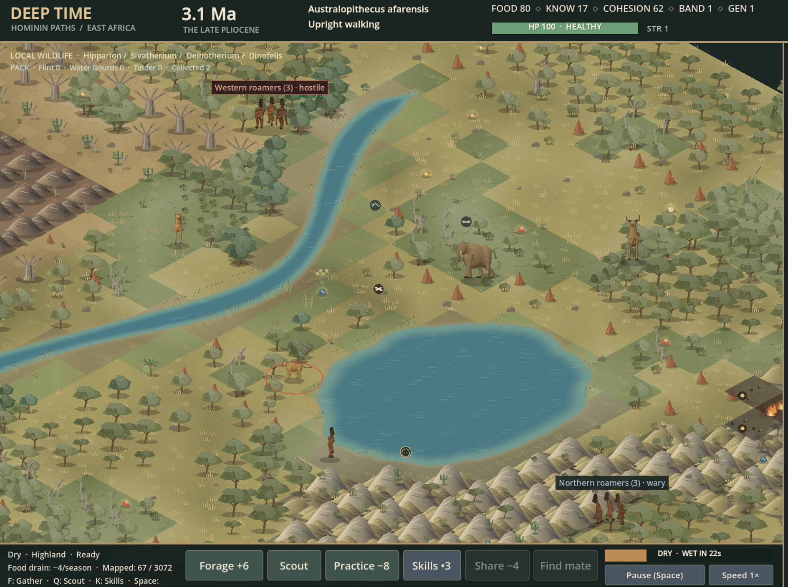

# Deep Time: Hominin Paths

A small Godot 4 experiment about early hominins roaming the East African Rift Valley, starting around 3.2 Ma. You move a band across the map, look for food and water during dry seasons, pick up things like flint or ochre, try not to get mauled by predators, and pass the lineage on to the next generation.

Everything in here is procedural (terrain, 3D figures, wildlife), so there are no external assets and the whole thing is mostly a few GDScript files. It's still rough around the edges and more of a sandbox than a finished game.

## Running it

Open the project in Godot 4.7 (`GL Compatibility` renderer) or run `./run.command` on macOS.

For the browser version, export the `Web` preset to `build/web/index.html` and run `./run-web.command` (it starts a small local Python server with the COOP/COEP headers Godot needs).

## AI Policy

100% vibe coded

## License

GPLv3

