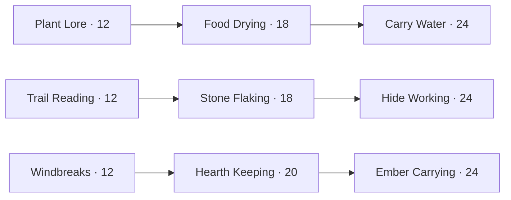

# Dawn of Men tech tree

Knowledge becomes a resource you spend on skills. With one hominin and one action per season, learning a skill competes directly with gathering food and scouting. The three branches help you survive inland, explore more efficiently, or get more from ground you already know.

## Tree

| Skill | Knowledge | Unlock condition | Gameplay effect |
| --- | ---: | --- | --- |
| Plant Lore | 12 | Available from the start | Forage yields +4 food in woodlands and wetlands during the wet season. |
| Food Drying | 18 | Plant Lore | Forage yields +3 food on land away from permanent water during the dry season. |
| Carry Water | 24 | Food Drying, discover the Spring-Fed Riverbank | Entering the dry season inland costs 8 food, down from 10. Permanent-water sites still cost 4. |
| Trail Reading | 12 | Available from the start | Scout radius grows from 4 to 5 tiles. Scout still requires unmapped tiles. |
| Stone Flaking | 18 | Trail Reading, discover the Obsidian Outcrop | Forage yields +4 food in savanna, dryland, and volcanic terrain in either season. |
| Hide Working | 24 | Stone Flaking, turn 24 | Unlock the existing hide-wrap model. Gain +2 cohesion after normal upkeep when entering the dry season inland. |
| Windbreaks | 12 | Available from the start | At highland tiles and the Sheltered Cliff, the low-food cohesion penalty drops from −3 to −1 when a season passes. |
| Hearth Keeping | 20 | Windbreaks, turn 22 (1.0 Ma) | Practicing at the Sheltered Cliff costs 4 food instead of 8. |
| Ember Carrying | 24 | Hearth Keeping, turn 24 (0.8 Ma) | Practicing anywhere costs at most 6 food. At the Sheltered Cliff it still costs 4. |

At 2.0 Ma, the chronicle introduces possible early fire use as a hypothesis. The branch first grants a fire ability at 1.0 Ma, when Hearth Keeping lets the player tend an existing fire. Ember Carrying represents preserving fire on the move. These are gameplay dates, with archaeological context in [Research Notes](RESEARCH_NOTES.md). Landmark requirements use the existing discovery state, so ordinary travel and Scout can both satisfy them.

## Earning and spending knowledge

- Begin with 12 knowledge. Keep Scout at +9, first contact at +4, and existing landmark rewards. The existing cap of 99 applies to unspent knowledge.
- Rename **Learn** to **Practice**. It still spends one seasonal action and normally trades 8 food for 15 knowledge. A **Skills** button opens the tree even while traveling or after acting.
- **Learn skill** spends the displayed knowledge and the current seasonal action. It requires the hominin to be stationary. The skill takes effect immediately and stays learned for the rest of the run.
- Replace the current automatic +4 forage bonus at 45 knowledge and the automatic hide-wrap unlock with the skills above. Apply applicable forage bonuses before capping the total at the remaining storage space. Lake forage stays at zero.

## What the player sees

Each skill shows its cost, effect, and any unmet prerequisites. A player can inspect the entire tree from the first turn. The live Forage and season buttons reflect learned skills so the player can check the exact payoff at their location. The chronicle records each unlock once.

An opening example is to spend the starting 12 knowledge on **Trail Reading**, enter the dry season near water, then use the wider Scout to look for the Obsidian Outcrop. An alternative is to take **Plant Lore** and save the next wet-season action for a strong forage tile. A player who camps in the highlands can instead take **Windbreaks** and save knowledge for the hearth branch.

## Wildfire aftermath

A dry-season wildfire can leave a small burn scar in fire-prone terrain. While flames are active, the area is unsafe. Once it cools, mark a short-lived Forage opportunity. A successful action can recover a one-time bonus from exposed roots, seeds, or insects. The normal seasonal action cost applies.

When the wet season arrives, surviving burned patches enter regrowth. Show fresh shoots and signs of grazing, then return the patch to ordinary terrain by the next dry season. Scale the frequency of burn events to the region. See [Research Notes](RESEARCH_NOTES.md#opportunities-after-wildfire) for the evidence behind this design.

Foraging on a cooled scar is available regardless of the player’s fire skills. Hearth Keeping later opens a separate opportunity to recover an ember from a recently burned patch. Ember Carrying lets the player bring it away from the site.

## First playtest

Aim for four to six learned skills in an ordinary 32-season run. Buying all nine costs 164 knowledge and nine seasonal actions. Even the water branch costs 54 knowledge and three actions, so its first two skills need to help the player before the upkeep discount arrives. Check that each opening skill has a viable first dry season and that the hearth branch is worth pursuing during the final ten seasons. These are tuning targets for the first implementation.
